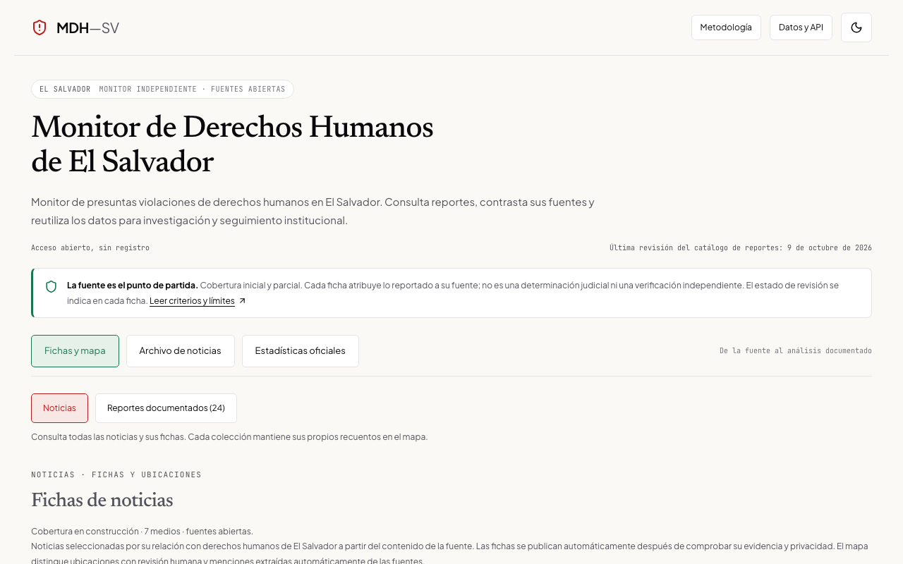
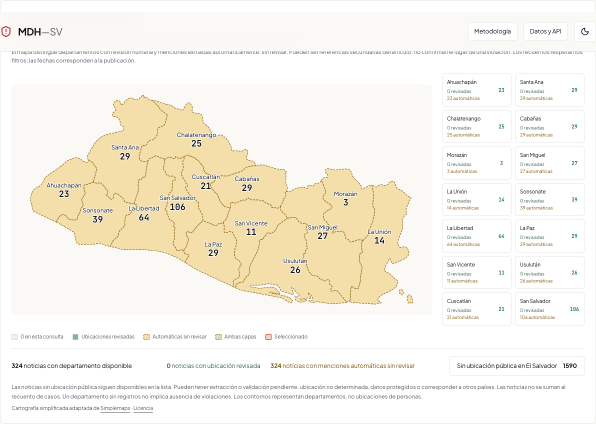
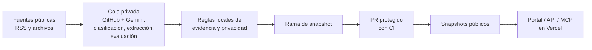

<div align="center">

# MDH-SV · Monitor de Derechos Humanos de El Salvador

Monitor independiente de reportes de presuntas violaciones de derechos humanos: catálogo documental, archivo de noticias con fichas estructuradas y estadísticas oficiales, con API y portal públicos.

[](https://github.com/RauPro/MDH-SV/actions/workflows/ci.yml)
[](https://github.com/RauPro/MDH-SV/releases)
[](LICENSE)
[](LICENSE-DATA.md)
[](https://mdh-sv.vercel.app/api/v1/openapi.json)
[](docs/API.md#mcp-remoto)
[](https://www.python.org/)
[](https://nodejs.org/)

[](https://mdh-sv.vercel.app/api/v1/news?limit=1&coverage=summary)
[](https://mdh-sv.vercel.app/api/v1/stats)
[](https://mdh-sv.vercel.app/api/v1/official-statistics)

[Portal](https://mdh-sv.vercel.app) · [API](docs/API.md) · [MCP](https://mdh-sv.vercel.app/mcp) · [Datos abiertos](#acceso-a-los-datos) · [Documentación](#documentación) · [Contribuir](#contribuir)

</div>

> **An independent human-rights monitor for El Salvador.** It publishes cases documented by human-rights organisations, a separate archive of human-rights news since 2010 and the official homicide statistics, each record traceable to its source. A private Gemini-assisted review queue drafts news dossiers that are published automatically, single-source and unreviewed; the public API, portal and remote MCP serve only the published snapshots.

## Qué es

- **Casos documentados por organizaciones de derechos humanos:** 17 reportes individuales (una persona o un hecho), 2 reportes colectivos y 5 informes de contexto, tomados de publicaciones de Human Rights Watch, Cristosal, Amnistía Internacional, CIDH, Corte IDH, Procedimientos Especiales de la ONU, Citizen Lab y Access Now. Cada registro identifica su fuente y un localizador y está comprobado contra su documento fuente, sin revisión editorial humana (`source_checked`); se sirve en [`/api/v1/records`](https://mdh-sv.vercel.app/api/v1/records).
- **Archivo de noticias desde 2010:** referencias seleccionadas por pertinencia y vínculo con El Salvador, cada una con una ficha estructurada, en [`/api/v1/news`](https://mdh-sv.vercel.app/api/v1/news). Es una colección aparte: las noticias nunca se cuentan como casos y el catálogo no recibe casos de las noticias automáticamente. Siete fuentes registradas; hoy la mayoría de las referencias proviene de Diario Co Latino, y El Faro y La Prensa Gráfica aún no aportan (esta última tiene acceso automatizado restringido). [Cobertura por fuente y mes en vivo](https://mdh-sv.vercel.app/api/v1/news/coverage).
- **Estadísticas oficiales de homicidios 2010–2026:** agregados por año y departamento con fuentes y cobertura explícita, consultados con revisión privada previa.





> [!IMPORTANT]
> **Qué no es.** No es un censo ni una determinación judicial; no mide prevalencia ni suma personas entre fuentes. El catálogo es una muestra documental limitada con revisión editorial pendiente. La selección automática no es revisión humana y las fichas de noticias son automáticas, de una sola fuente y sin revisión humana (`human_reviewed: false`, `single_source`); una sola fuente no es corroboración independiente. Las organizaciones citadas no patrocinan ni validan el proyecto.

## Acceso a los datos

| Recurso | Dónde |
| --- | --- |
| Portal público | [mdh-sv.vercel.app](https://mdh-sv.vercel.app) |
| REST | `/api/v1/records`, `/api/v1/records/{id}`, `/api/v1/news`, `/api/v1/news/coverage`, `/api/v1/stats`, `/api/v1/official-statistics` — [guía](docs/API.md) |
| OpenAPI 3.1 | [`/api/v1/openapi.json`](https://mdh-sv.vercel.app/api/v1/openapi.json) |
| MCP remoto | `https://mdh-sv.vercel.app/mcp` — Streamable HTTP, lectura anónima sin clave |
| Descargas | [CSV](https://mdh-sv.vercel.app/data/records.csv), [GeoJSON](https://mdh-sv.vercel.app/data/records.geojson), [Parquet](https://mdh-sv.vercel.app/data/records.parquet) y [JSON](https://mdh-sv.vercel.app/data/catalog.json) del catálogo; [noticias](https://mdh-sv.vercel.app/archive/news.json) y [estadísticas](https://mdh-sv.vercel.app/statistics/homicides.csv) |
| Releases reproducibles | [Releases](https://github.com/RauPro/MDH-SV/releases) con artefactos deterministas y manifiesto — [política](docs/RELEASES.md) |

```sh
curl 'https://mdh-sv.vercel.app/api/v1/news?limit=1&coverage=summary'
```

```js
import { Client } from '@modelcontextprotocol/sdk/client/index.js';
import { StreamableHTTPClientTransport } from '@modelcontextprotocol/sdk/client/streamableHttp.js';

const client = new Client({ name: 'mi-consulta', version: '1.0.0' });
await client.connect(new StreamableHTTPClientTransport(
  new URL('https://mdh-sv.vercel.app/mcp')));
const result = await client.callTool({ name: 'search_news', arguments: { q: 'detención', limit: 3 } });
await client.close();
```

## Cómo funciona



- Las decisiones humanas prevalecen sobre las automáticas, que se conservan por separado.
- Las fichas automáticas declaran `human_reviewed: false` y `automation.corroboration: single_source`: una segunda pasada de Gemini no es una fuente independiente.
- Los datos sensibles o no consignados se omiten o se marcan explícitamente; no se inventan datos.
- La API pública nunca consulta la cola privada; la clave de Gemini nunca llega a Vercel, al navegador ni al repositorio público.
- Fuente pública canónica: `data/reviewed/publications.json`; validador y exportador `python -m mdh_pipeline.publication`; el manifiesto SHA-256 comprueba los archivos, no la veracidad de los hechos. Las geometrías públicas son nulas: el departamento no representa un lugar preciso.

Detalles en [Gemini en la cola](docs/GEMINI-REVIEW.md), [fichas de noticias](docs/NEWS-DOSSIERS.md), [selección temática](docs/NEWS-SELECTION.md) y [operación](docs/OPERATIONS.md).

## Desarrollo

Requisitos: **Python 3.13** y **Node 22** (mínimo 22.12), declarados en `.python-version` y `.nvmrc`; las dependencias se instalan desde los locks.

```sh
python3.13 scripts/bootstrap.py      # .venv, dependencias fijadas, Gitleaks, Chromium
.venv/bin/python scripts/check.py    # comprobación completa (--audit con seguridad)
```

Para pruebas y desarrollo:

```sh
npm ci                                      # dependencias del servidor fijadas
npm run test:api                            # API pública y contratos OpenAPI
npm run dev:api                             # API local en escucha (servidor)
npm --prefix apps/web ci                    # dependencias web fijadas
npm --prefix apps/web test                  # Vitest de la web
npm --prefix apps/web run build             # compilar dist/
npm --prefix apps/web run test:browser      # Playwright sobre dist/
npm --prefix apps/web run dev               # portal local en escucha (servidor)
```

El módulo Python `.venv/bin/python -m mdh_mcp.server` conserva el transporte local `stdio`. Las pruebas y la web local no requieren secretos. Guías: [CONTRIBUTING](CONTRIBUTING.md) y [forks e instancias](docs/FORKS.md).

## Documentación

| Área | Documentos |
| --- | --- |
| Uso de datos | [API](docs/API.md) · [Contratos y fixtures](docs/CONTRACTS.md) · [Estadísticas oficiales](docs/OFFICIAL-STATISTICS.md) · [Recuperación de homicidios de 2015](docs/HOMICIDE-RECOVERY.md) · [Ubicaciones automáticas](docs/AUTOMATIC-LOCATIONS.md) · [Referencia municipal](docs/MUNICIPALITY-REFERENCE.md) · [Fuentes de artículos](docs/ARTICLE-SOURCES.md) · [Releases y compatibilidad](docs/RELEASES.md) |
| Metodología y fichas | [Metodología](docs/METHODOLOGY.md) · [Esquema de ficha](docs/DOSSIER-SCHEMA.md) · [Fichas de noticias](docs/NEWS-DOSSIERS.md) · [Selección temática](docs/NEWS-SELECTION.md) · [Corpus editorial](docs/EDITORIAL-CORPUS.md) · [Registro de fuentes](docs/SOURCES.md) · [Expansión de fuentes 2026-10-09](docs/SOURCE-EXPANSION-2026-10-09.md) |
| Operación | [Operación](docs/OPERATIONS.md) · [Ingreso horario](docs/HOURLY-INGESTION.md) · [Gemini en la cola](docs/GEMINI-REVIEW.md) · [Workflows de GitHub Actions](docs/GITHUB-ACTIONS.md) · [Calidad y presupuestos](docs/QUALITY.md) · [Cola privada](ops/review-queue/README.md) · [Historia](ops/history/README.md) |
| Contribución y forks | [CONTRIBUTING](CONTRIBUTING.md) · [AGENTS](AGENTS.md) · [Forks](docs/FORKS.md) · [MAINTAINERS](MAINTAINERS.md) |
| Seguridad y privacidad | [SECURITY](SECURITY.md) · [Publicación y secretos](docs/PUBLICATION-SECURITY.md) · [Historial de secretos](docs/SECRET-HISTORY.md) · [Reporte privado](docs/PRIVATE-REPORTING.md) · [Borradores privados](docs/PRIVATE-DRAFTS.md) · [Auditoría de producción 2026-10-09](docs/AUDIT-2026-10-09.md) |

## Uso responsable y correcciones

Contraste cada reporte con su documento original. No use las fichas para determinar culpabilidad, elegibilidad o riesgo de personas. Para errores no sensibles, use los formularios públicos con el identificador del registro. Para correcciones sensibles o retiradas, use el [canal editorial privado](SECURITY.md#correcciones-editoriales-sensibles-y-retiradas); no necesita abrir un issue público. Las vulnerabilidades técnicas tienen un canal privado separado en [Seguridad](SECURITY.md). No adjunte denuncias, nombres de personas protegidas ni documentos privados al primer contacto. El objetivo de primera respuesta privada es de 7 días naturales, orientativo y sin atención de emergencias.

## Contribuir

Lea [CONTRIBUTING.md](CONTRIBUTING.md), el [Código de Conducta](CODE_OF_CONDUCT.md) y [MAINTAINERS.md](MAINTAINERS.md). Los issues etiquetados [«good first issue»](https://github.com/RauPro/MDH-SV/issues?q=is%3Aissue%20state%3Aopen%20label%3A%22good%20first%20issue%22) y [«help wanted»](https://github.com/RauPro/MDH-SV/issues?q=is%3Aissue%20state%3Aopen%20label%3A%22help%20wanted%22) son un buen punto de partida.

## Citar

La referencia recomendada está en [CITATION.cff](CITATION.cff):

> Guillén Hernández, R. E. (2026). *MDH-SV: Monitor de Derechos Humanos de El Salvador* (Versión 2.1.0) [Software]. https://github.com/RauPro/MDH-SV

Antecedente de investigación: Guillén Hernández, R. E., Canizales Turcios, R. A. y Erazo Alfaro, M. E., [«Generative AI-based tool for efficient processing of Human Rights violations-related news»](https://ieeexplore.ieee.org/document/10933836), 2024 IEEE 42nd Central America and Panama Convention (CONCAPAN XLII), DOI [10.1109/CONCAPAN63470.2024.10933836](https://doi.org/10.1109/CONCAPAN63470.2024.10933836). El monitor amplía la implementación de ese artículo; su fecha es un antecedente, no el límite inicial del archivo.

## Licencia

- **Código:** MIT ([LICENSE](LICENSE)).
- **Metadatos y resúmenes propios:** CC BY 4.0 ([LICENSE-DATA.md](LICENSE-DATA.md)).
- **Documentos originales:** conservan los derechos de sus autores.
- **Terceros:** cartografía simplificada adaptada de [Simplemaps](https://simplemaps.com/svg/country/sv) con su [licencia](https://simplemaps.com/resources/svg-license); tipografías servidas localmente bajo sus licencias ([apps/web/public/FONT-LICENSES.txt](apps/web/public/FONT-LICENSES.txt)).

## Transparencia del historial

El prototipo contenía registros sintéticos atribuidos a organizaciones reales; se excluyeron del conjunto público y sólo se conservan localmente. El historial antiguo también contenía una credencial incrustada: esta publicación comienza con un historial limpio que no la incluye, y su identificación y eliminación quedaron documentadas. Detalles en [docs/SECRET-HISTORY.md](docs/SECRET-HISTORY.md).
