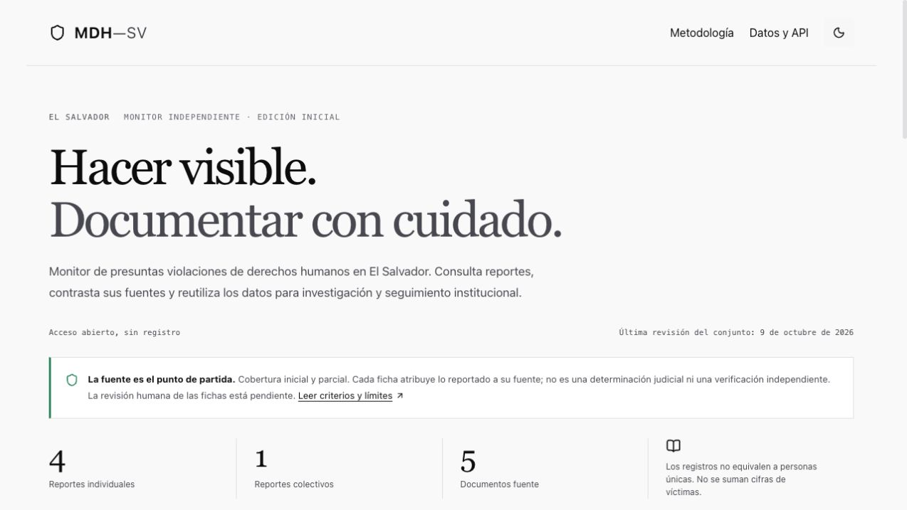

# Auditoría de publicación · 9 de octubre de 2026

## Resultado

El monitor está publicado en https://mdh-sv.vercel.app y el código auditado está en https://github.com/RauPro/MDH-SV. La versión técnica verificada es `54fa10af1ea5df0a92194f160342f54add67025a`; el commit posterior de este informe solo incorpora evidencia y documentación.

**Apto como edición pública inicial de consulta, con cobertura parcial y revisión editorial humana pendiente. No se certifica como fuente exhaustiva, censo ni evidencia judicial.** Para adopción institucional sostenida faltan responsable editorial, revisión humana de las fichas, ampliación de cobertura y canal confidencial de contacto. La ingesta no publica automáticamente.

## Hallazgos y correcciones

| Hallazgo | Evidencia local del prototipo | Resolución |
| --- | --- | --- |
| Registros sintéticos atribuidos a ONG | 979 filas; al menos 720 generadas mediante nombres, fechas y circunstancias aleatorias; 931 etiquetadas como confirmadas | Conjunto anterior excluido de Git, web, descargas y MCP. Semillero deshabilitado. Nueva fuente canónica explícita |
| Credencial de Google incrustada | Código legado y commit histórico original | Código legado fuera de la publicación; clave retirada del archivo local; historial público nuevo sin esos objetos. Pendiente de revocación a fecha de esta auditoría. Seguimiento del 16 de octubre de 2026: el titular confirmó la identificación exacta y eliminación con confirmación de Google; [P0.3 cerrado](SECRET-HISTORY.md) |
| Certeza automática injustificada | Fusión por penal/tipo y promoción por número de medios; heurística por palabras | Fusión automática restringida a reingestas idénticas. Sin promoción de certeza por IA o multifuente |
| Fechas, lugares y archivos inventados | Sustitución de desconocidos por fecha actual/San Salvador; fallback de Wayback sin snapshot | Desconocidos explícitos, geometrías públicas nulas y fechas diferenciadas. No se devuelve archivo confirmado ante timeout |
| Cifras engañosas | Suma de víctimas de informes superpuestos; desconocido sustituido por uno | Conteos separados por tipo de registro; sin total de personas |
| Pruebas contaminaban la base real | Test MCP insertaba un registro en la base de trabajo | MCP público de solo lectura; pruebas no escriben en esa base |
| API remota ficticia y descargas incoherentes | Endpoints mdhsv.org no desplegados; exportaciones duplicadas | Enlaces del mismo origen, MCP local real y manifest único comprobado en prebuild |
| Accesibilidad y robustez | Tarjetas no accesibles por teclado, diálogos sin gestión de foco, ausencia de error de carga | Botones semánticos, diálogo nativo, Escape, foco, estados de carga/error/reintento y modo sin almacenamiento |
| Dependencias vulnerables | source-map-js y PyJWT | Actualizaciones a versiones corregidas; auditorías finales sin vulnerabilidades conocidas |

## Verificaciones ejecutadas

- **38 pruebas Python**: dominio, almacenamiento, exportaciones, protección frente a fórmulas CSV, procedencia, privacidad, fronteras de publicación, deduplicación, archivo y consultas MCP.
- **19 pruebas frontend**: búsqueda sin tildes, filtros, tipos de registro, fechas desconocidas e invertidas, fichas y citas, enlaces, errores de red, reintentos, localStorage denegado y accesibilidad estructural con axe. El contraste no se evaluó mediante axe/JSDOM y no se afirma certificación WCAG.
- TypeScript estricto, lint y build de producción aprobados.
- CI de instalación limpia con Python 3.13 y Node 22: [ejecución aprobada](https://github.com/RauPro/MDH-SV/actions/runs/38020944848).
- Conexión MCP real por stdio: herramientas listadas y consulta paginada de Sonsonate, con dos registros totales y uno devuelto.
- Navegador real: escritorio, viewport móvil de 390 × 844, temas claro/oscuro, búsqueda, ficha por URL, Escape, restauración de foco y consulta de un intervalo que se solapa con un reporte colectivo. Sin errores de consola en producción durante los recorridos comprobados.
- Acceso HTTP anónimo a producción: portada 200; JSON, CSV, GeoJSON, Parquet y manifest disponibles. Hashes de los cuatro datasets iguales al manifest; Parquet legible con nueve filas.
- Recursos inexistentes y rutas de `.env`, SQLite, dataset antiguo y cuarentena: **404**, sin fallback HTML que oculte el error.
- Cabeceras verificadas: CSP, HSTS, X-Content-Type-Options, X-Frame-Options, Referrer-Policy y Permissions-Policy.
- Cinco documentos fuente: Citizen Lab, Amnistía y CIDH responden 200 por HTTP. HRW devuelve 403 al cliente automatizado, pero ambos informes se abrieron correctamente en navegador. El bloqueo automatizado queda documentado y no se interpreta como desaparición del documento.
- JavaScript principal: ~247 kB sin comprimir, ~78 kB gzip; el prototipo incluía ~3 MB de JavaScript con datos incrustados. Dataset JSON separado: ~15 kB.
- 79 rutas de código/configuración verificadas antes de publicar, sin archivos de ejecución privados ni coincidencias de credenciales en los patrones revisados. Esta comprobación no sustituye una auditoría independiente completa.

## Conjunto inicial

Cuatro reportes individuales, un reporte colectivo y cuatro informes de contexto; cinco documentos fuente. Las fichas contienen resúmenes atribuidos, localizadores y fechas explícitas, sin nombres de víctimas ni ubicaciones personales. `human_reviewed=false` es visible y se conserva en todas las exportaciones.

Al realizar esta auditoría, los materiales del prototipo permanecían locales en `data/`, `legacy/` y `.local-quarantine/`, además del respaldo de la sesión en `/private/tmp/mdh-audit-original`. No se subieron al repositorio nuevo. Seguimiento del 16 de octubre de 2026: las referencias históricas se retiraron tras verificar un bundle privado recuperable; el titular confirmó la eliminación de la credencial en Google. La recuperación permanece fuera de las referencias publicables y no debe subirse al repositorio público. Véase el [registro de cierre de P0.3](SECRET-HISTORY.md).

